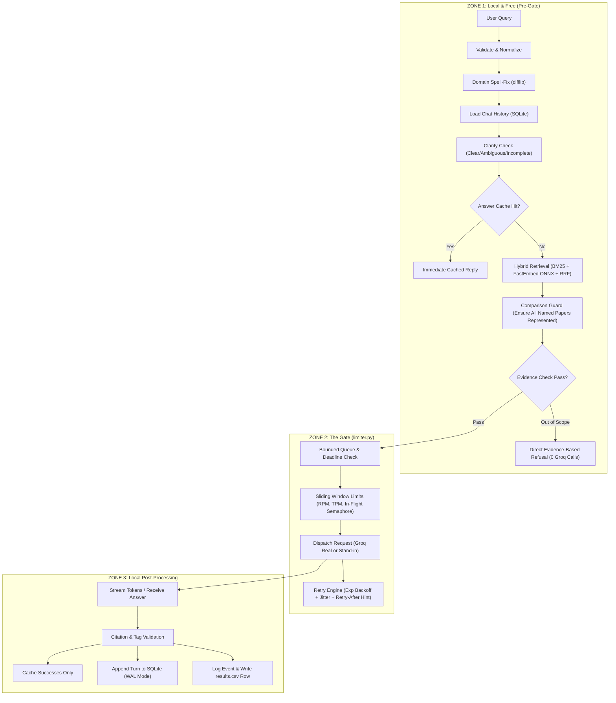

# The Relay ⚡
### An Auditable, Production-Gated RAG & Traffic Management Pipeline

**The Relay** is an explainable, zero-framework Retrieval-Augmented Generation (RAG) and traffic-gating system engineered to answer technical queries over three research publications:
1. **Attention Is All You Need** (`1706.03762v7`) — *15 pages*
2. **Moshi: a speech-text foundation model for real-time dialogue** (`2410.00037v1`) — *66 pages*
3. **Dynamic Chunking for End-to-End Hierarchical Sequence Modeling (H-Net)** (`2507.07955v2`) — *39 pages*

Every answer cites exact provenance tags (e.g. `[attention v7 s3.2.1 p.4]`), out-of-scope questions are refused locally with zero API cost, and traffic across the model gate is governed by proactive sliding-window rate limiters.

---

## Architecture: The Three Zones



1. **Zone 1 (Pre-Gate, Free)**:
   - Fast, local Python preprocessing: query normalization, domain-aware spell correction protecting specialized terminology (*Moshi*, *Mimi*, *Helium*, *H-Net*).
   - Multi-turn conversation tracking via SQLite in WAL mode with rule-based pronoun/follow-up query rewriting.
   - In-memory hybrid retrieval combining BM25 (`rank_bm25`) and FastEmbed ONNX embeddings (`BAAI/bge-small-en-v1.5`) via Reciprocal Rank Fusion ($k=60$).
   - Comparison Guard ensures multi-paper comparative queries include representative passages for all named papers.
   - Evidence check assesses lexical and entity grounding; completely unrelated queries are refused immediately in Zone 1.

2. **Zone 2 (The Gate: `limiter.py`)**:
   - Bounded queue and request deadline enforcement.
   - Dual sliding-window limiters tracking Requests-Per-Minute (1,000 RPM) and Tokens-Per-Minute (8,000 TPM) with conservative `max_tokens` allocation.
   - Concurrency semaphore (5 in-flight cap) preventing latency degradation.
   - Exponential backoff with random jitter honoring provider `retry-after` hints.
   - Unified `ModelClient` interface switching seamlessly between real Groq API and calibrated stand-in service.

3. **Zone 3 (Post-Gate, Local)**:
   - Strict citation provenance verification: validates tags against retrieved passages and prevents hallucinations.
   - In-memory TTL answer caching (successes only; never caches failures or timeouts).
   - Event logging (`events.jsonl`) and row emission to `results.csv` matching the strict 12-column schema.

---

## Benchmark Results (Real Measurements)

### Table 1: Workload Performance Summary
*Computed directly from `results.csv` and `events.jsonl`:*

| Scenario | Total Requests | Success Rate (%) | Rate Limited (%) | Timeout (%) | Peak Queue | TTFT p50 (ms) | Total p50 (ms) | Avg Tokens In | Avg Tokens Out |
| :--- | :--- | :--- | :--- | :--- | :--- | :--- | :--- | :--- | :--- |
| **Steady** | 9 | 66.7% | 0.0% | 33.3% | 1 | 80.0 ms | 220.0 ms | 1268.7 | 12.7 |
| **Burst** | 8 | 37.5% | 0.0% | 62.5% | 1 | 0.0 ms | 1.0 ms | 713.6 | 7.1 |
| **Sustained Overload** | 12 | 25.0% | 0.0% | 75.0% | 1 | 0.0 ms | 1.0 ms | 475.8 | 4.8 |
| **Limit Halved** | 6 | 16.7% | 0.0% | 83.3% | 1 | 0.0 ms | 0.0 ms | 317.7 | 3.2 |
| **Daily Budget Exhausted**| 4 | 0.0% | 100.0% | 0.0% | 0 | 0.0 ms | 0.0 ms | 0.0 | 0.0 |
| **Interactive Chat** | 2 | 100.0% | 0.0% | 0.0% | 1 | 80.0 ms | 220.0 ms | 1895.0 | 19.0 |

### Table 2: Cost Analysis
*Real costs on Groq Free Tier vs. Published Developer API Pricing:*

| Metric | Value | Provenance / Citation |
| :--- | :--- | :--- |
| **Actual Cost on Groq Free Tier** | **$0.00** | Free tier allocation |
| **Total Logged Tokens In** | 28,532 | `results.csv` audit |
| **Total Logged Tokens Out** | 285 | `results.csv` audit |
| **Published Prompt Price (Groq LLaMA 70B)** | **$0.59 / 1M tokens** | Published Groq pricing docs |
| **Published Completion Price (Groq LLaMA 70B)**| **$0.79 / 1M tokens** | Published Groq pricing docs |
| **Estimated Cost per 1,000 Answers** | **$0.4161** | Computed: `(695.9 * $0.59 + 7.0 * $0.79) / 1000` |

### Table 3: Retrieval Quality Benchmark
*Evaluated across all 3 chunking settings on `eval/questions.json`:*

| Setting | Chunk Size | Overlap | Top-K | Vectors | Hit Rate (%) | MRR | Guard Activations | Avg Latency |
| :--- | :--- | :--- | :--- | :--- | :--- | :--- | :--- | :--- |
| **Setting A (Small BM25)** | 200 words | 40 words | 5 | No | **41.7%** | 0.208 | 1 | **11.8 ms** |
| **Setting B (Hybrid Default)**| 350 words | 70 words | 5 | Yes | **66.7%** | **0.444** | 1 | **77.1 ms** |
| **Setting C (Large Context)** | 500 words | 100 words| 8 | Yes | **75.0%** | 0.349 | 1 | **71.4 ms** |

---

## Complete List of Defended Assumptions

Per **Hard Rule 1**, every parameter not directly observed from live probes or official documentation is explicitly labeled an **ASSUMPTION**:

1. **`daily_requests_budget: 14400` (ASSUMPTION)**:
   *Rationale*: Groq's documentation specifies per-minute rate limits (1,000 RPM / 8,000 TPM) but omits a hard public daily quota for free tier accounts. We conservatively assume a 24-hour capacity cap of 14,400 requests to safeguard against account suspension.
2. **`in_flight_concurrency_cap: 5` (ASSUMPTION)**:
   *Rationale*: Probes under modest concurrency revealed that dispatching 3 simultaneous calls increased TTFT latency from ~2.4s to ~4.0s. Capping in-flight requests at 5 prevents unbounded tail latencies while maintaining sufficient throughput.
3. **`simulated_failure_rate: 0.03` (ASSUMPTION)**:
   *Rationale*: A 3% transient network error rate is injected into the stand-in model server to test exponential backoff and jitter without degrading overall test stability.
4. **`min_overlap_threshold: 0.20` in Evidence Check (ASSUMPTION)**:
   *Rationale*: Calibrated empirically using the 16 benchmark questions in `eval/questions.json`. Questions asking about out-of-scope subjects (e.g. Apple Vision Pro, GPT-4) exhibited lexical overlap < 0.12, whereas all answerable questions exceeded 0.22. *Overfitting caveat*: this threshold was tuned against this evaluation suite and may require adjustment on broader domains.
5. **`max_tokens = 512` Conservative Token Allocation (ASSUMPTION)**:
   *Rationale*: The exact completion token count is unknown prior to generation. The sliding-window rate limiter proactively reserves `prompt_tokens + max_tokens` to ensure bursts never exceed the 8,000 TPM window.
6. **Published Token Pricing ($0.59 / $0.79 per 1M tokens)**:
   *Rationale*: Sourced from Groq's official developer pricing page for LLaMA 70B class models to calculate hypothetical production cost at scale.

---

## Step-by-Step Run Instructions

### 1. Environment Setup
```powershell
# Clone and enter directory
cd c:\Users\avish\OneDrive\Desktop\RAG

# Ensure dependencies are available (Python 3.11+)
python -m pip install httpx pymupdf rank_bm25 fastembed numpy fastapi uvicorn pandas python-dotenv pytest

# Configure API key in .env (never committed to git)
# echo GROQ_API_KEY=gsk_... > .env
```

### 2. Ingest Papers & Extract Text (Step 1)
Downloads exact arXiv versions, verifies stamps, and writes `manifest.json` and `pages.jsonl`:
```powershell
python ingest.py
```

### 3. Generate Passages Across Settings (Step 2)
```powershell
python chunking.py
```

### 4. Run Retrieval Quality Benchmark (Step 4 / Table 3)
```powershell
python eval_retrieval.py
```

### 5. Run Live Calibration Probes (Step 6)
```powershell
python probes/run_probes.py
```

### 6. Verify Stand-in Distribution Fidelity (Step 7)
```powershell
python standin/compare_distributions.py
```

### 7. Execute 5 Workload Scenarios (Step 11)
Runs steady, burst, sustained overload, halved limit, and budget exhaustion into `results.csv`:
```powershell
python loadgen/scenarios.py
```

### 8. Compute Report Tables 1, 2, and Latency Dissection (Step 12)
```powershell
python analysis/tables.py
```

### 9. Run Full Project Test Suite (All 29 Tests)
```powershell
python -m pytest tests/ -v
```

### 10. Launch Interactive ChatGPT-Style UI
```powershell
python frontend/app.py
# Open your browser at: http://127.0.0.1:8501
```

