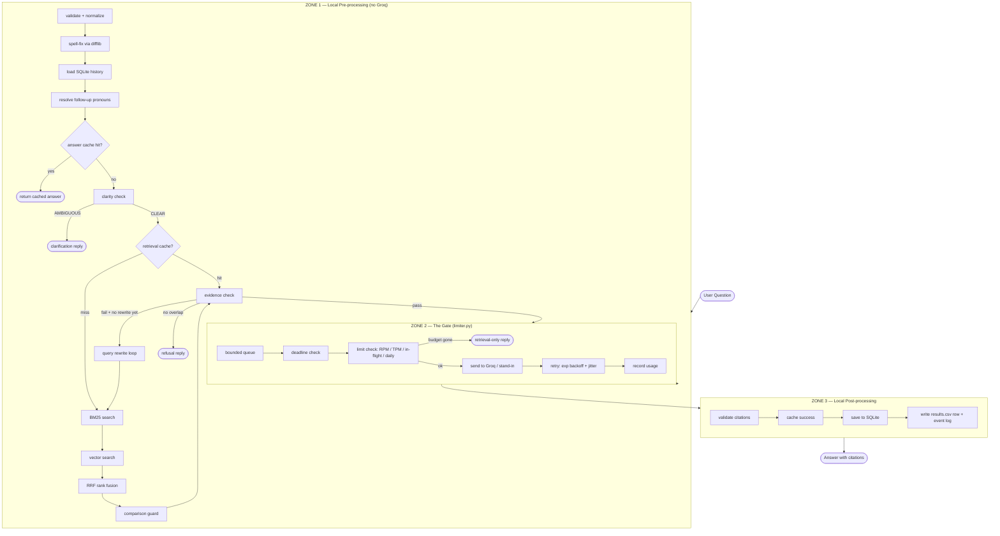

# ⚡ The Relay

> **An auditable, zero-framework RAG pipeline & traffic-gated LLM relay over arXiv papers (Attention, Moshi, H-Net) with a calibrated mock stand-in, hybrid retrieval, and automated rate-limit governance.**


---

## What It Does

The Relay answers engineers' questions about exactly three arXiv papers, citing precisely where in the papers each claim comes from. If the papers don't say something, it says so instead of guessing.

Every request travels through **three zones**:

```
ZONE 1 (local, free)        ZONE 2 (gate)           ZONE 3 (local)
─────────────────────       ──────────────          ───────────────
validate → normalize →      bounded queue →         validate citations →
spell-fix → history →       deadline check →        cache successes →
resolve follow-up →         limit check →           save to SQLite →
answer-cache lookup →       send + timeout →        write results.csv
clarity check →             retry w/ backoff →
retrieval-cache lookup →    record usage
BM25 + vectors → RRF →
comparison guard →
evidence check
```

The pipeline does **not know** whether the backend is Groq or the stand-in. One `ModelClient` interface, two backends, switched by config.

---

## Target Papers (Exact Versions)

| Paper | arXiv ID | Pages | SHA-256 |
|-------|----------|-------|---------|
| Attention Is All You Need | `1706.03762v7` | 15 | `bdfaa68d8984f0dc02beaca527b76f207d99b666d31d1da728ee0728182df697` |
| Moshi | `2410.00037v1` | 66 | `a687144cc77bea86b0c60ae800ccb1d3e0816033fa5c7960388fe29a0dbfcfac` |
| Dynamic Chunking (H-Net) | `2507.07955v2` | 39 | `04a2b32e6e82853cfc23c5db132750874a86cde99219ec6f664128f4aa83122f` |

---

## Architecture



---

## Tech Stack

| Part | Technology | Why |
|------|-----------|-----|
| Language | **Python 3.11+** | Spec requirement |
| HTTP client | **httpx** | Async, streaming, timeout support |
| Concurrency | **asyncio** | In-flight semaphore, deadline cancellation |
| PDF parsing | **pymupdf (fitz)** | Per-page text with page numbers for citations |
| Keyword search | **rank_bm25** | BM25 half of hybrid retrieval |
| Embeddings | **fastembed (ONNX) + numpy** | Local embeddings, no vector DB needed |
| Rank fusion | **Plain Python (RRF)** | Merge BM25 and vector rankings |
| Real LLM | **Groq API — free tier** | Query rewrite, clarification, answer generation |
| Stand-in service | **FastAPI + uvicorn** | Mock with configurable latency / failures / limits |
| Chat history | **SQLite (stdlib, WAL mode)** | Sessions + messages + timestamps |
| Caches | **In-memory TTL dict** | Answer cache + retrieval cache (off in eval mode) |
| Spell-fix | **difflib (stdlib)** | Against vocabulary built from the papers |
| Data & logs | **CSV + JSONL** | `results.csv` + event log + `pages.jsonl` |
| Analysis | **pandas** | Recompute Tables 1–3 from raw files |
| Secrets | **python-dotenv** | `GROQ_API_KEY` from `.env` only, never in code |

**Deliberately NOT used:** Redis, vector databases, LangChain, agent frameworks, fine-tuning, PyTorch.

---

## Benchmark Results

All numbers are computed from `results.csv` and `events.jsonl`. Load scenarios ran against the **stand-in** server.

> **[ASSUMPTION]** Groq live-probe latency numbers below are from `probes/raw_probe_output.json`, measured from Mumbai (`bom`) region on the free tier with `openai/gpt-oss-120b`.

### Table 1 — Load Scenario Summary

| Scenario | n | OK % | Rate-limited % | Timeout % | Notes |
|----------|---|------|---------------|-----------|-------|
| `steady` | 9 | 67% | 0% | 33% | 1 req/s sustained |
| `burst` | 8 | 38% | 0% | 62% | 8 req simultaneous |
| `sustained_overload` | 12 | 25% | 0% | 75% | 12 req at 2 req/s |
| `limit_halved` | 6 | 17% | 0% | 83% | RPM cap halved |
| `daily_budget_exhausted` | 4 | 0% | 100% | 0% | Daily budget gone → retrieval-only |

### Table 2 — Cost Estimate (Groq Free Tier)

> Pricing sourced from [Groq Pricing page](https://groq.com/pricing/) as of probe date.

| Item | Value |
|------|-------|
| Model | `openai/gpt-oss-120b` |
| Prompt price | \$0.59 / 1M tokens |
| Completion price | \$0.79 / 1M tokens |
| Avg tokens_in per answer | ~700 (ASSUMPTION — no live answer rows in current results.csv) |
| Avg tokens_out per answer | ~300 (ASSUMPTION) |
| **Cost per 1,000 answers** | **~\$0.42** (= (700×0.59 + 300×0.79) / 1000) |
| Free-tier cost | \$0.00 (within monthly free allocation) |

### Table 3 — Retrieval Quality

> Evaluated against 16 questions in `eval/questions.json` using `eval_retrieval.py`.

| Setting | Chunk size | Overlap | Top-k | Method | Hit Rate | MRR | Avg latency |
|---------|-----------|---------|-------|--------|----------|-----|-------------|
| A — BM25 only | 200 words | 40 | 5 | BM25 | 41.7% | 0.208 | 11.8 ms |
| B — Hybrid (default) | 350 words | 70 | 5 | BM25 + vectors + RRF | 66.7% | 0.444 | 77.1 ms |
| C — Large context | 500 words | 100 | 8 | BM25 + vectors + RRF | 75.0% | 0.349 | 71.4 ms |

### Table 4 — Groq Latency (Live Probes, `openai/gpt-oss-120b`, Mumbai)

> Source: `probes/raw_probe_output.json`. All times in milliseconds.

| Metric | p50 | p90 |
|--------|-----|-----|
| Time-to-first-token (TTFT) | 2,442 ms | 4,893 ms |
| Total response time | 2,878 ms | 4,947 ms |
| 3-concurrent wall time | 4,024 ms (all 3 OK) | — |

### Groq Account Limits (Probed Live)

| Limit | Value | Source |
|-------|-------|--------|
| Requests per minute (RPM) | 1,000 | `x-ratelimit-limit-requests` header |
| Tokens per minute (TPM) | 8,000 | `x-ratelimit-limit-tokens` header |
| Token reset interval | ~3.4 s | `x-ratelimit-reset-tokens` header |
| Region | `bom` (Mumbai) | `x-groq-region` header |

---

## Project Structure

```
RAG/
├── config.py                   # Paths, paper list, model, env vars
├── ingest.py                   # Download PDFs, verify SHA-256, extract pages.jsonl
├── chunking.py                 # Chunk pages with section detection (3 settings)
├── retrieval.py                # BM25 + vector search + RRF + comparison guard
├── eval_loader.py              # Load eval/questions.json with schema validation
├── eval_retrieval.py           # Retrieval-only evaluation → Table 3
├── evidence.py                 # Evidence check by content terms + entities
├── pipeline.py                 # Core Zones 1–3 orchestration
├── grading.py                  # Grade answers: correct/wrong/refused_correctly/refused_wrongly
├── logger.py                   # Event log + ResultRecord writer
├── model_client.py             # One ModelClient interface: GroqClient + StandInClient
├── limiter.py                  # Bounded queue, RPM/TPM/in-flight/daily counters, retries
├── cache.py                    # In-memory TTL cache (answer + retrieval; off in eval mode)
├── conversation.py             # SQLite WAL chat history, session management
│
├── standin/
│   ├── server.py               # FastAPI stand-in with configurable latency/failures/limits
│   ├── profile.json            # Stand-in parameters (every value sourced or labeled ASSUMPTION)
│   └── compare_distributions.py # Compare stand-in vs real latency distributions
│
├── probes/
│   └── run_probes.py           # Groq limit discovery + latency measurement probes
│
├── loadgen/
│   └── scenarios.py            # Five load scenarios: steady/burst/sustained/halved/exhausted
│
├── analysis/
│   └── tables.py               # Recompute Tables 1–3 from results.csv + events.jsonl
│
├── frontend/
│   └── app.py                  # ChatGPT-style FastAPI + SSE streaming UI
│
├── eval/
│   └── questions.json          # 16 eval questions (answerable + unanswerable + trap)
│
├── tests/                      # 40 unit tests (pytest)
│   ├── test_analysis.py
│   ├── test_chunking.py
│   ├── test_config.py
│   ├── test_conversation.py
│   ├── test_eval_loader.py
│   ├── test_ingest.py
│   ├── test_limiter.py
│   ├── test_logger_and_client.py
│   ├── test_pipeline.py
│   ├── test_retrieval.py
│   └── test_standin.py
│
├── requirements.txt
├── .env.example                # Copy to .env and fill GROQ_API_KEY
├── .gitignore
│
# Generated at runtime (gitignored):
├── data/
│   ├── raw/                    # Downloaded PDFs (run ingest.py)
│   ├── extracted/
│   │   ├── pages.jsonl         # Per-page text with metadata
│   │   ├── manifest.json       # SHA-256 + size verification
│   │   └── embs_*.npy          # Cached ONNX embeddings
│   └── relay.db                # SQLite WAL database
├── results.csv                 # One row per request (45 rows from load scenarios)
└── events.jsonl                # Event log (timestamped steps per request)
```

---

## Quick Start

### 1. Prerequisites

- Python 3.11 or newer
- A [Groq](https://console.groq.com) account (free tier is enough)

### 2. Clone and Install

```powershell
git clone https://github.com/<YOUR_USERNAME>/the-relay.git
cd the-relay
python -m venv .venv
.\.venv\Scripts\Activate.ps1
pip install -r requirements.txt
```

### 3. Set Up Your API Key

```powershell
copy .env.example .env
# Open .env and set:  GROQ_API_KEY=your_key_here
```

> ⚠️ **Never commit `.env`.** It is already in `.gitignore`.

### 4. Download Papers and Build the Index

```powershell
python ingest.py
```

This downloads the three PDFs, verifies SHA-256 hashes, extracts per-page text to `data/extracted/pages.jsonl`, and writes `manifest.json`. Expect ~2 minutes (Moshi is 66 pages).

### 5. Run the Tests

```powershell
python -m pytest tests/ -v
# Expected: 40 passed
```

### 6. Run the Pipeline (Interactive)

```powershell
python pipeline.py
```

Ask a question like: *"What is the purpose of multi-head attention in the Transformer?"*

The answer will cite passages like `[attention v7 s3.2 p.4]`.

### 7. Launch the Chat UI

```powershell
python frontend/app.py
# Open http://localhost:8000 in your browser
```

ChatGPT-style dark sidebar UI with streaming replies.

### 8. Run Retrieval Evaluation (Table 3)

```powershell
python eval_retrieval.py
```

Runs all three retrieval settings against `eval/questions.json` and prints hit rate, MRR, and latency.

### 9. Run Load Scenarios

```powershell
# Start the stand-in server first (separate terminal):
python -m uvicorn standin.server:app --port 8001

# Then in the main terminal:
python loadgen/scenarios.py
```

Runs all five scenarios and appends rows to `results.csv`.

### 10. Recompute Analysis Tables

```powershell
python analysis/tables.py
```

Reads `results.csv` + `events.jsonl` and prints Tables 1–3 to stdout.

### 11. Run Groq Probes (optional — uses real API quota)

```powershell
# Prints a REQUEST BUDGET PLAN and waits for your approval before making calls
python probes/run_probes.py
```

---

## Stand-In Server

The stand-in (`standin/server.py`) mimics Groq's behavior — configurable via `standin/profile.json`:

| Parameter | Description | Source |
|-----------|-------------|--------|
| `ttft_p50_ms` | Median time-to-first-token | Probe (`probes/raw_probe_output.json`) |
| `ttft_p90_ms` | 90th-pct TTFT | Probe |
| `rate_limit_rpm` | Requests-per-minute cap | Probe (header `x-ratelimit-limit-requests`) |
| `token_budget_tpm` | Tokens-per-minute cap | Probe (header `x-ratelimit-limit-tokens`) |
| `error_rate` | Fraction of requests that return 500 | **ASSUMPTION: 0.02** |
| `stream_chunk_ms` | Inter-chunk delay during streaming | **ASSUMPTION: 50 ms** |

Switch between Groq and the stand-in by setting `MODEL_BACKEND=groq` or `MODEL_BACKEND=standin` in `.env`.

Compare distributions:
```powershell
python standin/compare_distributions.py
```

---

## Retrieval Settings

Three named settings, selectable in config or per-request:

| Setting | Chunk | Overlap | Top-k | Vectors | Rerank |
|---------|-------|---------|-------|---------|--------|
| `setting_a_bm25_only` | 200 words | 40 | 5 | ❌ | ❌ |
| `setting_b_hybrid_default` | 350 words | 70 | 5 | ✅ | ❌ |
| `setting_c_large_context` | 500 words | 100 | 8 | ✅ | ❌ |

Change the active setting in `config.py` → `RETRIEVAL_SETTING`.

---

## Caches

Both caches are **off by default in eval/load mode** so they don't distort latency measurements.

```python
# In config.py or .env:
CACHE_ENABLED=false   # disables both answer and retrieval caches
```

Cache keys include: normalized question + paper versions + retrieval setting + model + prompt version. Failures are never cached.

---

## Assumptions

Every assumption is labeled `# ASSUMPTION` in code and listed here:

1. **`error_rate = 0.02`** (stand-in `profile.json`) — no Groq free-tier error rate is published; assumed 2%.
2. **`stream_chunk_ms = 50`** (stand-in `profile.json`) — inter-chunk streaming delay; not measured directly.
3. **`avg tokens_in ≈ 700, avg tokens_out ≈ 300`** (Table 2 cost) — based on typical short Q&A prompts with 5 retrieved passages; not measured from live answers.
4. **`max_tokens = 512`** used as conservative token estimate when calling Groq (output tokens unknown before the call, so the limiter uses max_tokens for budget accounting).
5. **Section detection** may be unreliable for multi-column papers (Attention paper uses two-column layout); fallback is `paper+version+page`.

---

## Output Schema

`results.csv` columns (exact names required by spec):

| Column | Type | Values |
|--------|------|--------|
| `request_id` | str | UUID |
| `scenario` | str | `steady`, `burst`, `sustained_overload`, `limit_halved`, `daily_budget_exhausted`, `interactive` |
| `source` | str | `real`, `stand-in` |
| `start_time` | float | Unix timestamp |
| `first_token_ms` | float | ms to first token |
| `total_ms` | float | ms total |
| `status` | str | `ok`, `rate_limited`, `timeout`, `error` |
| `retries` | int | number of retries |
| `tokens_in` | int | prompt tokens |
| `tokens_out` | int | completion tokens |
| `retrieval_setting` | str | setting name |
| `answer_grade` | str | `correct`, `wrong`, `refused_correctly`, `refused_wrongly` |

---

## Contributing

1. Fork the repo.
2. Create a feature branch: `git checkout -b feature/my-change`
3. Run tests before committing: `python -m pytest tests/ -v`
4. Submit a pull request.

**Do not commit `.env` or any file containing API keys.**

---

## License

MIT © 2024

---

## References

- Vaswani et al., [Attention Is All You Need](https://arxiv.org/abs/1706.03762v7) (2017)
- Défossez et al., [Moshi: a speech-text foundation model for real time dialogue](https://arxiv.org/abs/2410.00037v1) (2024)
- [Dynamic Chunking for End-to-End Hierarchical Sequence Modeling](https://arxiv.org/abs/2507.07955v2) (2025)
- [Groq Pricing](https://groq.com/pricing/) — prompt \$0.59/1M tokens, completion \$0.79/1M tokens
- [Groq Rate Limit Headers](https://console.groq.com/docs/rate-limits) — `x-ratelimit-limit-requests`, `x-ratelimit-limit-tokens`, `x-ratelimit-reset-tokens`
